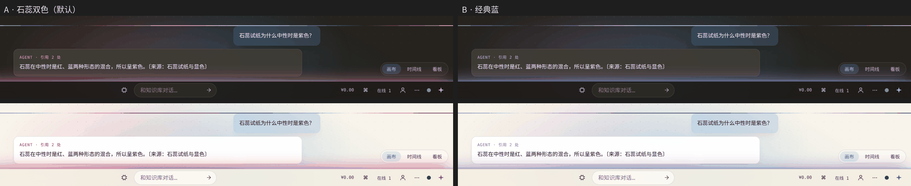
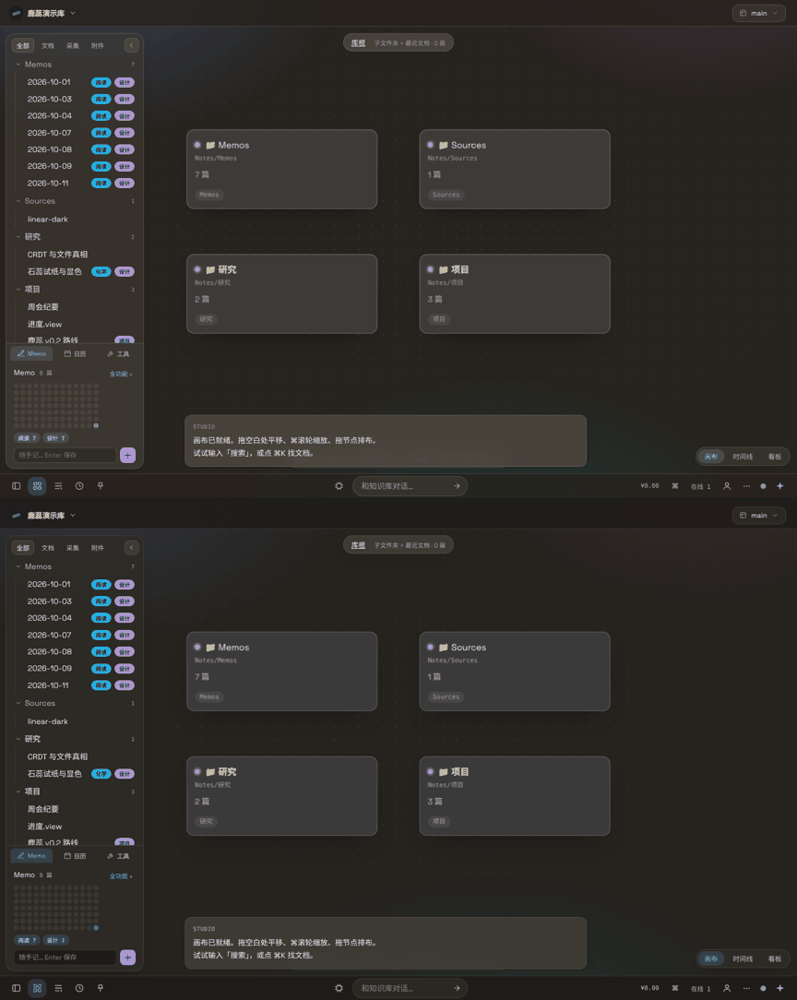
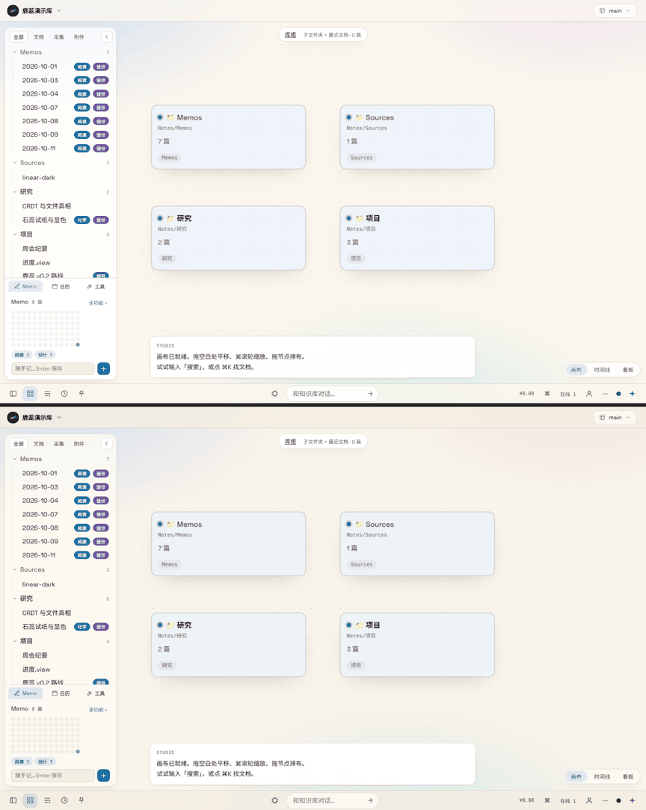
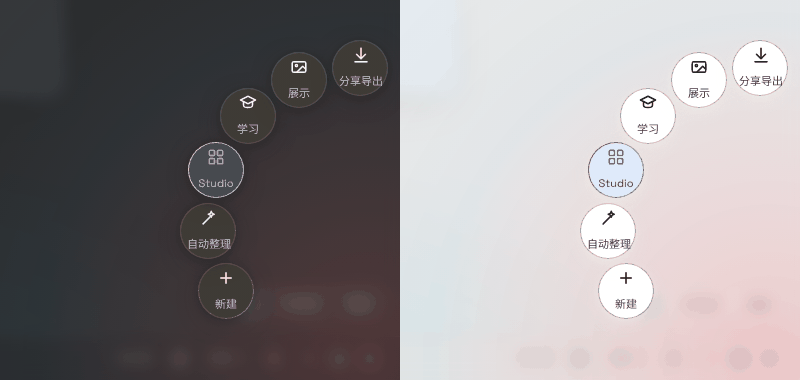
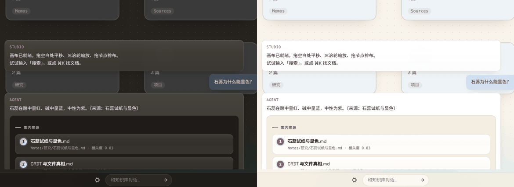
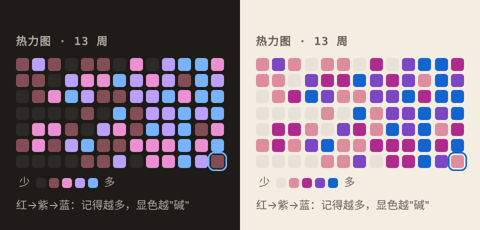
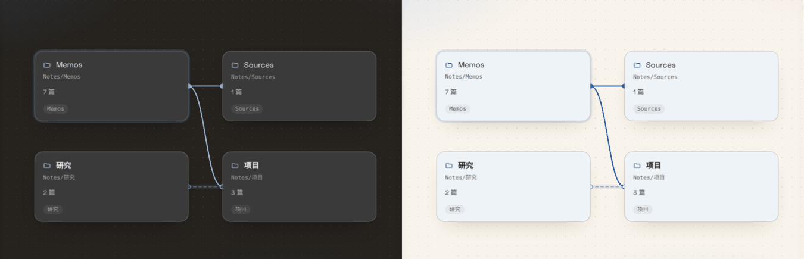
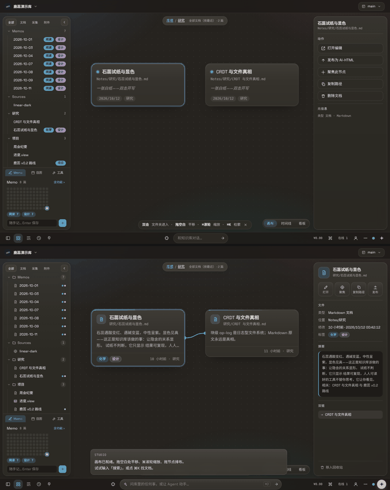
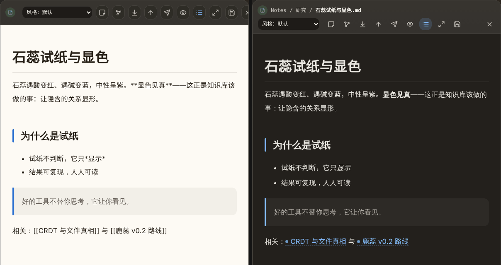

# ThirdC Design System

契约来源：**OpenFlow 前台设计系统**（`OpenFlow Dev/docs/DESIGN-SYSTEM.md` + `assets/tokens.css`）。
ThirdC 客户端不是自造一套视觉，而是**沿用同一份契约**，保证两个产品的观感同源。

## 三层结构（照搬）

```
server/web/tokens.css   设计契约：颜色（全 oklch）、字体、圆角、阴影、缓动、明暗模式
server/web/index.html   <style> 只放本页独有部件
```

硬规则：

| 规则 | 说明 |
|---|---|
| **零 hex / 零 rgb** | 颜色只能来自 token；派生用 `color-mix(in oklab, …)` |
| **动效统一弹簧** | 一律 `var(--ease-spring)`（cubic-bezier(.32,.72,0,1)）；`prefers-reduced-motion` 下即时 |
| **圆角三档** | `--r-lg:26` / `--r-md:18` / `--r-sm:12` |
| **图标只有一种** | 24×24 线框 svg，`stroke-width:1.8`，圆角端点，颜色跟 `currentColor`，不直出 emoji |
| **玻璃表面** | `--surface` / `--surface-strong` + `backdrop-filter: blur() saturate()` |
| **字体** | Space Grotesk（显示/正文）+ JetBrains Mono（代码/元信息）+ 系统中文字体回退 |
| **对比度** | `--faint` 亮 51% L / 暗 64% L，正文级小字 ≥4.5:1（WCAG AA） |

## ThirdC 增补 token

画布与对话是新场景，扩展了以下 token（同样遵守零 hex）：

| token | 用途 |
|---|---|
| `--node-bg` / `--node-bg-active` | 画布节点表面 |
| `--node-w` / `--node-shadow` | 节点宽度与投影 |
| `--grid-dot` | 画布点阵底纹 |
| `--edge` / `--edge-soft` | 知识图谱连线（强/弱） |
| `--type-doc` `--type-capture` `--type-asset` `--type-query` | 数据类型色：文档/采集/附件/检索 |
| `--chat-bg` / `--chat-w` | 对话舱 |

## 新增零件的门槛（继承 OpenFlow 规则）

- 第二个页面要用同一个东西，才进 `tokens.css`；只在一个视图用的留在页面 `<style>`。
- 页面 CSS 里不得出现 hex/rgb，不得重定义共享类。
- 新增必须给 ≤1080 / ≤860 降档，并同时检查亮暗两色。
- 命名沿用短名风格（`.node` `.n-head` `.n-hit`，不是 `.canvas-node-header`）。

## 已验证

`/assets/tokens.css` 与 `/assets/fonts/*.woff2` 由 daemon 直接托管（内嵌二进制 + 一年 immutable 缓存），
离线可用、无 CDN 依赖。

## 配色修订（2026-09-19）

反馈「太黑」后重做暗色与默认策略：

| 项 | 旧 | 新 |
|---|---|---|
| 默认主题 | 固定深色 | **跟随系统**（按钮循环 跟随系统 → 浅色 → 深色） |
| 暗色底 | `oklch(19% .014 70)`（近黑） | `oklch(26% .012 75)`（石墨），层级靠亮度差而非压黑 |
| 暗色表面 | 27% / 30% | 35% / 40%，玻璃更亮更"有厚度" |
| 亮色底 | 96.5% | 97.4% 暖纸 + `--bg-deep` 三级 |
| 新增 token | — | `--bg-deep` `--col-bg` `--col-head` `--axis`（看板/时间线用） |

仍是全 oklch、零 hex、弹簧缓动、圆角三档。

## 配色体系 v2（2026-10-12 · 工艺品化 PR①）

> 判据：任何一屏截图色彩层次 ≥4 级可见；对比度全部过 WCAG AA；oklch 零 hex。
> 三条都由 `server/tests/palette.rs` 在 `cargo test` 里强制，不靠肉眼复核。

### 层级 = 明度阶梯

五级表面 `bg-0 < bg-1 < surface-1 < surface-2 < surface-3`（k = 0…4），用公式而不是挑色：

| 主题 | 明度 L(k) | 色度 C(k) | 色相 h(k) | 借鉴 |
|---|---|---|---|---|
| 暗（主场景） | 22.5% + 3.2%·k | .007 + .0008·k | 70 + 2·k | Linear 的等差克制；越浮起越暖一点（Arc 的温度） |
| 亮 | 100% − 0.65%·(4−k)^1.5 | .016·(4−k)/4 | 84 | Things 的纸感：纸面最深，浮层趋白、色度褪尽 |

壳的落位（截图里可数出的层次）：

| 层 | token | 承载 |
|---|---|---|
| 框 | `bg-0` | 顶栏、底栏、移动导航；输入框/侧列等凹陷处（`--bg-soft`） |
| 底 | `bg-1` | 画布、Memo Hub/视图文件底（`--bg`） |
| 面 | `surface-1` | 侧栏、检查器、抽屉（`--surface` 玻璃） |
| 物 | `surface-2` | 画布节点（`--node-bg`） |
| 浮 | `surface-3` | 菜单、弹窗、选中态（`--surface-strong`） |

文字四级 `text-1…4`（旧名 `--fg/--muted/--faint` 映射前三级，`text-4` 只给占位符与禁用态），
边框两级 `border-1/2`（文字色的透明度，压在任何表面上都成立），语义四色 `ok/warn/danger/info` 各配 `-soft`，
新增 `--on-danger`、`--ring`、`--selection`。

### 对比度纪律（测试矩阵：亮/暗 × 两版强调色）

- `text-1/2/3`、`accent(-strong)`、`accent-2`、语义色 对五级表面全部 ≥ 4.5:1；
- 彩色文字压在自己的 `-soft` 底上 ≥ 4.5:1（徽章、标签、选中态）；
- `on-accent / on-accent-2 / on-danger` 压在对应底色上 ≥ 4.5:1；
- `text-4` 属 WCAG 1.4.3 豁免（占位/禁用/装饰），仍保证 ≥ 3:1；
- 暗色相邻表面级差 ≥ 1.08:1，保证在截图里可分辨。

### 强调色两版：石蕊双色 vs 经典蓝

主色都是石蕊蓝（`accent`，链接/选中/焦点环不变），差别只在副色 `accent-2` 与渐变 `--accent-grad`：

| | A · 石蕊双色（默认） | B · 经典蓝（`html[data-accent="blue"]`） |
|---|---|---|
| 副色 | 石蕊红 h≈10（遇酸显红） | 堇紫 h≈300（同色系演进） |
| 渐变 | 红 → 紫 → 蓝，oklch 插值走紫色短弧（石蕊的中性色恰好是紫） | 堇 → 蓝，安静 |
| 用在哪 | 只用于"显色"瞬间：AI 动词、Agent 署名与思考光、Magic 星标、启动环、光晕 | 同左 |

石蕊红**永不表示错误**：与 `--danger`（h≈29）色相相隔 ≥12°，测试强制；报错一律走 `--danger`。
切换：⌘K「切换强调色」，存 `localStorage.thirdc_accent`，启动脚本在首帧前落定，无闪烁。



前后对照（上：v1，下：v2）：




### 兼容

旧 token 名全部保留为别名（测试 `every_legacy_token_still_resolves` 守住），62 款阅读风格预设与插件
覆盖 `--bg/--fg/--accent…` 的方式不变。新原语（`surface-1…3`、`text-4`、`info`）不随预设变化，属有意为之：
它们是壳的骨架，不是阅读皮肤。

## 图标与字体纪律（2026-10-12 · 工艺品化 PR②）

### 图标：一套线性家族

- 唯一来源是 `index.html` 里的 `IC` 表 + `iconSvg(name, size)`：24 网格、圆端点圆拐角、`currentColor`；
  笔画统一由 `--icon-stroke: 2`（tokens.css）控制，`svg.ic` 与各容器的 `svg{stroke-width}` 都读它。
- 静态标记写 `<i data-ic="名" data-ics="尺寸">`，启动时注水；动态 HTML 直接拼 `iconSvg()`。
- 本次补齐 31 个图标（x / check / more / cmd / chevL / chevR / expand / spark / graph / quote / link / edit / move /
  folderPlus / copy / send / table / target / inbox / key / user / mail / film / book / square / branch / note / clip / long / code），
  替换掉 chrome 里全部 emoji：关闭 ✕ ×21、⋯、⌘ 底栏钮、🕸 图谱、编辑器工具栏、导出八格、右键菜单 41 项、
  画布文件夹节点（📁 → 节点头线性 folder 图标）、空态按钮、Agent 工具步骤 ✓/✕、AI 动词 ✦ → spark。
- 仍保留的字符：键盘记号 ⌘⇧↩（排印，不是图标）、外链 ↗、状态行里的 ✓/✗ 文字、写进用户文件的内容
  （📄 附件链接、🎙 录音）、62 款阅读风格的标题装饰（属"降级为装饰"，也在导出管线里）。
- `server/tests/craft.rs`：静态标记零象形符号；每个 `data-ic` / `iconSvg('…')` / 菜单 `{icon:'…'}` 都在 IC 表里。

### 字体排印：五级字号 × 行高配对

| token | 字号 | 行高 | 用途 |
|---|---|---|---|
| `--fs-1` | 11px | 1.45 | 微注：路径、计数、mono 标签、徽章 |
| `--fs-2` | 12.5px | 1.5 | 次要界面：按钮、菜单、侧栏条目 |
| `--fs-3` | 13.5px | 1.6 | 界面正文（body 默认）、对话、卡片正文 |
| `--fs-4` | 15px | 1.5 | 强调与面板标题、快记输入 |
| `--fs-5` | 19px | 1.3 | 展示标题：空态、引导、日历 |

- 原先 `<style>` 与静态标记里 19 种裸 px 字号（8.5…23）按"最近一级"归并到五级；`font:` 简写同时带上配对行高，
  长文阅读处（编辑器 1.8、memo 1.75）保留显式行高。`craft.rs` 禁止再出现裸 px 字号。
- 数字等宽：路径、计数、日期、分数、金额、计时器、表格单元一律 `font-variant-numeric: tabular-nums`，滚动/刷新时不跳。
- 标题类统一 `letter-spacing: -.01em`，Space Grotesk 在大字号下更紧致。

## 微交互动效（2026-10-12 · 工艺品化 PR③）

### 动效家族（tokens.css）

| 时长 | 值 | 用途 | | 曲线 | 用途 |
|---|---|---|---|---|---|
| `--dur-1` | .12s | 按压回弹 | | `--ease-spring` | 进场、位移（快起柔停） |
| `--dur-2` | .18s | 悬停、颜色、退场 | | `--ease-out` | 颜色、透明度 |
| `--dur-3` | .28s | 浮层进出、落位 | | `--ease-in` | 退场（先慢后快，干脆离开） |
| `--dur-4` | .45s | 面板 / 抽屉滑动 | | `--ease-in-out` | 往返、镜头 |
| `--dur-5` | .62s | 画布镜头 | | `--ease-bounce` | 落点回弹、磁吸 |

壳里原有 104 处 transition 时长与 16 处进场动画按最近一档归并；`craft.rs` 禁止 transition 再写裸秒数。
循环动画（spin / shimmer / aura / 思考光）不在此列。

### 一致的 enter / exit / hover / active

- 浮层（⋯ 菜单、固定板/最近弹层、右键菜单、动作栏、所有 `.overlay` 面板）：进场 `dur-3` 弹簧上浮，
  退场 `dur-2` ease-in 下沉淡出。用 `@starting-style` + `display … allow-discrete` 实现，`display:none` 也能播退场；
  老内核自动退化为即显即隐。
- 按压：所有可点物件 `:active` 收缩到 .97（`dur-1`）；卡片悬停微抬 1px + 投影（Memo 卡、视图卡）。
- 焦点环：`:focus-visible` 2px `--ring`，进场从 6px 外圈收拢到 2px（`ringIn`）；鼠标点击不出环。

### 键盘流

| 键 | 行为 |
|---|---|
| ⌘N | 新建文档（任何上下文；部分浏览器把 ⌘N 留给新窗口，桌面壳与 Safari 生效，单键 n 仍在） |
| ← → ↑ ↓ | 画布节点间按空间就近移动选中（主方向距离 + 2.2×横向偏移）；到边原地轻弹；越界自动平移镜头 |
| Enter | 打开选中节点（与双击同源：文件夹下钻 / 视图 / 文档） |
| Esc | 无浮层时取消选中 |
| Tab / ⇧Tab | 焦点已在控件上时交给浏览器原生遍历（焦点环接管）；焦点在页面本身时仍是"收起/唤回底栏" |

### 空状态与骨架

- 统一组件 `emptyState({ic,title,line,act})`：图标 + 一句有性格的话 + 一个行动按钮。已覆盖：画布空（库根/文件夹/透镜/加载失败）、
  侧栏过滤无果（→ 全文检索）、⌘K 无果（→ 问 Agent）、Memo 空 / 筛选无果（→ 写下第一条 / 清除筛选）、回收站空、视图无命中（→ 编辑视图源）、最近使用空。
- 骨架 `skelHTML(kind)`：Memo Hub 首开（卡片流）、视图文件（看板列 / 表格行）、A2UI 渲染（图表与卡片）、旧 Memo 面板。

### 拖拽物理（画布视图）

- 过 4px 才"抬起"：投影加深（`--shadow-lift`，分主题）、放大 3.5%、微倾 -.6°，表面转为不透明。
- 磁吸：对齐其他节点的左/中/右与上/中/下，以及标准间距（COL/ROW 节奏）；阈值是屏幕 10px（随缩放换算）。
  命中时显示石蕊红参考线 + 虚线落点框，节点仍跟手。
- 松手：沿 `--ease-bounce` 滑入落点并轻弹（settle）；看板拖拽保留列高亮并同样抬起。

### 动效可关

系统「减少动态效果」或 ⌘K「减少动效」任一开启：CSS 全部过渡/动画即时完成，JS 侧镜头动画、火花、景深倾斜、落位动画一并跳过。
偏好存 `localStorage.thirdc_motion`，首帧前落定。

## 信息密度与标志性瞬间（2026-10-12 · 工艺品化 PR④）

### 三档信息密度（不再一个样式打天下）

| 档 | 场景 | 规则 |
|---|---|---|
| 低 · 物件 | Studio 画布节点 | 圆角 `r-lg`、头部 14/16 留白、标题 `fs-4`、正文 `fs-2/1.65`——一张张放在桌面上的卡 |
| 中 · 行 | 侧栏树、弹层、Memo 流、视图卡 | 行高 30–32px、`fs-2`、整行悬停着色；Memo 卡 14/16 内边距 |
| 高 · 格 | 视图表格、整月日历 | 行高 28px、mono 表头吸顶、斑马纹、首列 `fg` 其余 `muted`、单元格省略号、数字等宽 |

### 质感体系

- 物件感 = 细边框 + 顶沿高光（`--inset-hi`）+ 极淡竖向渐变（`--sheen`），分主题调校：暗色是顶沿 7% 白光，亮色是纸面受光。
  覆盖节点、面板、侧栏、检查器、抽屉、对话气泡、Memo/视图卡、所有浮层、Magic 扇叶。
- 毛玻璃半径从 10 种（2/6/8/10/12/14/16/18/20/22px）收敛为两档：`--blur-1: 8px`（遮罩）/ `--blur-2: 18px`（玻璃表面），
  `craft.rs` 禁止第三种。
- 画布连线：光晕（9px 低透明）+ 主线 1.8px 圆端 + 两端端口圆点；选中节点的关系被点亮（主线转 `accent`、光晕转 `accent-2`）；
  端口挂在节点真实竖向中线，不再按固定 `NODE_H` 偏上。

### 标志性瞬间（深化既有，不新增元素）

1. **Magic 扇形**：打开时光从锚点升起（石蕊双色径向光晕），扇叶悬停/当前态换石蕊渐变描边，展开落位走 `--ease-bounce`。
   
2. **A2UI 来源卡 → 引文卡**：引用协议 surface（含 Link 的列）渲染成编号引文——石蕊渐变编号徽章 + 标题 + mono 路径与相关度，
   悬停整卡描边；"未按协议标注"提示换成 `warn-soft` 条。只作用于引用 surface，其他 A2UI 不受影响。
   
   顺带修复两处让来源卡出不了图的协议缺陷（服务端 `append_citation_surface`）：缺 `beginRendering` 导致渲染器按协议拒绝出图；
   Link 的文字子组件被同时挂到 root，标题会在卡外再渲染一遍。测试改为真正调用渲染器验证。
3. **Memo 热力图 → 石蕊显色**：0 篇灰纸，1 篇泛红（酸），越多越经紫转蓝（碱）；改成按周纵排（与侧栏迷你图一致）、
   逐列入场、悬停放大、今天加焦点环、带图例。经典蓝版本自动变为堇→蓝。
   



## 第二轮：看得见的工艺（2026-10-12 · PR⑤）

第一轮四个 PR 建的是"体系"（token、纪律、测试），肉眼差异偏细。第二轮直击打开应用第一眼就能看到的地方：

| 位置 | 之前 | 之后 |
|---|---|---|
| 画布卡片 | 只有标题，正文一律显示"空文档"（`/browse` 不返回摘要） | 类型图标瓷片 + 标题/路径 + 三行摘要 + 页脚（标签 · 相对时间）；顶沿一条类型色光；文件夹是"一摞纸"（身后两层错位纸边）+ 大号篇数 |
| 画布连线 | 浏览模式永远没有连线 | `[[双链]]` 自动显形为连线（不写回任何文件）；端口按相对位置选边（右→左 / 左→右 / 下→上） |
| 标签 | 饱和实心色块 | 着色胶囊（文字色 + 15% 底 + 22% 描边）；侧栏树里降为色点，悬停看名字 |
| 侧栏树 | 纯文字 | 文件夹/文档/视图/HTML/剪藏类型图标；选中行石蕊渐变竖条 |
| 检查器 | 一列描边大按钮 | 类型瓷片头 + 四格快捷动作 + 键值信息（类型/位置/修改/内容/标签）+ 摘要 + 双链进出（可跳转）+ 底部弱化的删除 |
| 阅读视图 | **原样显示 `**粗体**`、`*斜体*`、`[[双链]]`**；暗色主题里是一块亮白纸 | kernel-md 行内渲染：粗/斜/删除/高亮/行内代码/链接/双链/裸链接/#标签/任务清单；默认风格跟随应用明暗；双链可点击跳转 |
| 抽屉头 | 路径被十个按钮挤没、最后一个按钮被裁掉 | 第一行路径、第二行幽灵图标工具条，关闭钮靠右 |
| 底栏 | 小输入框"和知识库对话…" | AI 输入成为主角：更宽、火花图标、⌘J 直达、聚焦时石蕊渐变描边；Magic 变成渐变宝珠 |
| 移动端 | 输入胶囊被挤到只剩图标（旧问题） | 与底部导航重复的入口让位，输入框完整可用 |

服务端只加字段不改语义：`/browse` 的每篇文档多了 `excerpt` / `tags` / `links`，仍是同一次 2KB 读取（性能预算不变）。
行内渲染先整体转义再识别记号，`javascript:` 链接不生成 href（`inline_markdown_renders_and_stays_safe` 测试守住）。



